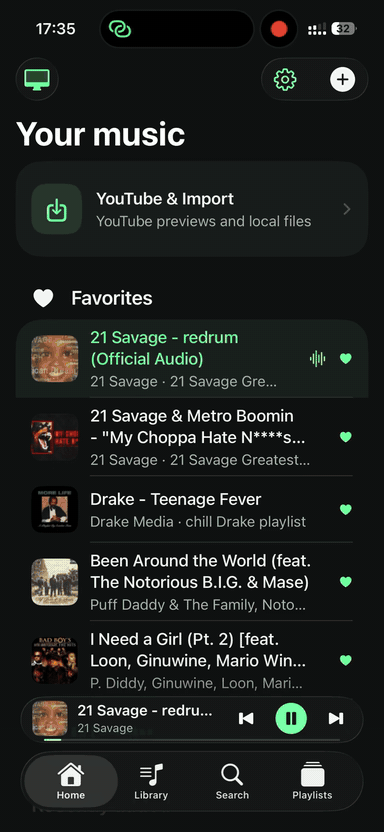

# jox · Offline Music Player

[](https://developer.apple.com/ios/)
[](https://developer.apple.com/xcode/swiftui/)
[](#license)

jox is a native offline music player for iPhone, built with SwiftUI, SwiftData
and AVFoundation. Import your own music, organize it and listen offline. Your
local library needs no account or internet connection.

The repository also contains an optional local Mac Companion. It can convert
and transfer audio files from a Mac to a paired iPhone over local HTTPS. The
Companion is not a public server and does not configure port forwarding,
firewall rules or a login item automatically.

## Demo



## Documentation languages

The app is localized in English and the 11 languages below. Choose a language
in **Settings → Language** or follow the device language. The full documentation
is in English. Short summaries are available in [11 additional languages](README-translations/README.md).

| Language | Summary |
| --- | --- |
| Deutsch | [README](README-translations/README.de.md) |
| Español | [README](README-translations/README.es.md) |
| Français | [README](README-translations/README.fr.md) |
| Italiano | [README](README-translations/README.it.md) |
| Português (Brasil) | [README](README-translations/README.pt-BR.md) |
| Nederlands | [README](README-translations/README.nl.md) |
| Polski | [README](README-translations/README.pl.md) |
| Türkçe | [README](README-translations/README.tr.md) |
| 日本語 | [README](README-translations/README.ja.md) |
| 한국어 | [README](README-translations/README.ko.md) |
| 简体中文 | [README](README-translations/README.zh-Hans.md) |

## Features

- **Offline library** with recursive folder import, metadata, embedded artwork,
  artist and genre matching, and duplicate management.
- **Favorites and playlists** with smart playlists and a favorites filter in
  **Library → Artists** and on artist pages.
- **Playback** with a mini-player, Now Playing, background audio, lock-screen
  controls, Bluetooth, shuffle, crossfade, gapless playback and a sleep timer.
  Playback wraps to the first track at the end of the list. **Repeat One**
  loops the current track, and **Next** still advances.
- **Audio editing** with a waveform, precise in and out points, preview, undo
  and redo. Keep a selected range or remove it and join the surrounding audio.
- **Optional YouTube search and preview** using your own YouTube Data API key
  and the official YouTube player. See [YouTube and Import](YOUTUBE_IMPORT.md).
- **Optional Mac Companion** for pairing, converting and transferring authorized
  audio from your Mac over local HTTPS.

The dark interface uses mint accents, compact song rows and native glass on
iOS 26. The mini-player uses the native tab accessory on iOS 26.1 and later.

## Get started

1. From **Home**, choose **YouTube & Import** or import a file or folder using
   the add button. Playback and browsing work offline after import.
2. Tap a song to play it. Open the mini-player for the full playback controls.
3. Tap the heart to save a favorite. In **Library → Artists**, choose
   **Favorites** to see your liked songs grouped by artist.

### Edit a song

In **Now Playing**, open **Playback Settings** with the sliders button and
choose **Trim Audio**. Drag the two handles to mark the range. **Keep Selection**
keeps that range, while **Remove Selection** cuts it out and joins the audio
before and after it. Use **Preview the Join** to hear the transition.

Under **Save**, choose **Create New Clip** to add a library entry or
**Trim Original** to apply the edit to the existing entry. Playlists and
favorites then use the edited version of that song.

## Requirements

- A Mac with Xcode 26.1 or later and the iOS SDK. See [Xcode system requirements](https://developer.apple.com/xcode/system-requirements/).
- An iPhone running iOS 17 or later, or an installed iPhone simulator runtime.
- For a physical iPhone, sign in to Xcode with an Apple Account and select a
  signing team. See [Apple’s device setup instructions](https://developer.apple.com/documentation/xcode/running-your-app-on-simulated-or-physical-devices).
- macOS 14 or later if you use the packaged Mac Companion.

## Build the iOS app

1. Open `OfflineMusic.xcodeproj` in Xcode.
2. Select the `OfflineMusic` scheme and an iPhone simulator, then press **Run**.
3. To run on an iPhone, select your team in the target’s **Signing & Capabilities**,
   enable **Automatically manage signing**, and use a bundle identifier available
   to your team. Select the connected iPhone and press **Run**.

## Mac Companion

The easiest route is to open GitHub **Releases** and download the matching
Companion ZIP: `arm64` for Apple silicon or `x86_64` for Intel. Setup details:

- [Download and start the Mac Companion](MAC_APP.md)
- [Pair an iPhone with the Mac](MAC_CONNECTION.md)
- [Import finished Mac files on the iPhone](MAC_IMPORT.md)
- [Companion API and security details](COMPANION.md)
- [Converter API](CONVERTER.md)

For local development, create a Python environment and initialize the service.

```sh
python3 -m venv .venv-companion
.venv-companion/bin/python -m pip install -r requirements-companion.txt
./start-companion.sh init
./start-companion.sh serve
```

The default library is `~/Music/YouTube`. Use `--root /absolute/path` before
the command to choose another library. The service listens on local HTTPS and
requires explicit pairing before an iPhone can access it.

## YouTube and copyright

The iOS YouTube feature uses the official YouTube Data API and official player
preview. It does not provide a download button. The Companion accepts only
explicitly authorized local files or sources, and the caller must have the
necessary rights. Do not download or import copyrighted material without
permission. See [YouTube and Import](YOUTUBE_IMPORT.md) for the exact behavior.

The legacy `playlist.py` command-line tool remains available. The reusable
conversion implementation is in `converter_core.py`; there is no `convert.py`
or `converter.py` entry point.

## Tests

The tests use temporary libraries, generated audio and local test servers. Install
the Companion test dependencies before running the Python suites.

```sh
python3 -m venv .venv-companion
.venv-companion/bin/python -m pip install -r requirements-companion-test.txt
.venv-companion/bin/python -m unittest discover -s Tests -p 'test_*.py' -v
.venv-companion/bin/python Tests/run_mac_connection_tests.py
.venv-companion/bin/python Tests/run_mac_import_tests.py
python3 Tests/run_youtube_tests.py
python3 Tests/run_swift_regressions.py
DEVELOPER_DIR=/Applications/Xcode.app/Contents/Developer python3 Tests/check_localization.py
```

To build the app for the simulator with signing disabled, use full Xcode.

```sh
DEVELOPER_DIR=/Applications/Xcode.app/Contents/Developer xcodebuild \
  -project OfflineMusic.xcodeproj -scheme OfflineMusic \
  -sdk iphonesimulator -destination 'generic/platform=iOS Simulator' \
  CODE_SIGNING_ALLOWED=NO build
```

The localization audit checks the compiled strings, plural variants and permission
prompts in all 12 languages. See [QUALITY_CHECK.md](QUALITY_CHECK.md) for the
recorded verification scope and physical-device checks.

## Repository layout

| Path | Purpose |
| --- | --- |
| `OfflineMusic/` | SwiftUI iOS app, audio engine and local library |
| `MacCompanion/` | Packaged macOS Companion build scripts and runtime |
| `companion_*.py` | Local HTTPS service, pairing and security |
| `converter_core.py` | Durable conversion and validation engine |
| `playlist.py` | Legacy interactive converter CLI |
| `Tests/` | Python, Swift and integration tests |
| `.github/workflows/` | GitHub Actions workflow for Companion artifacts/releases |
| `README-translations/` | Short README summaries in 11 additional languages |

## Privacy and security

- Music and library metadata remain local unless the user explicitly transfers
  a file to a paired iPhone.
- The Companion uses local HTTPS, certificate pinning and one-time pairing
  secrets.
- Long-lived device tokens are stored in the iOS Keychain and only hashes are
  stored by the Companion.
- No API key, token, certificate private key or personal music file belongs in
  this repository.

## Releases

The workflow **Download Mac Companion** builds Apple-silicon and Intel ZIPs.
Running it manually creates artifacts. Pushing a tag matching
`companion-v*` creates a draft GitHub release for review.

The generated Companion is ad-hoc signed and not Apple-notarized. A normal
public distribution requires the maintainer's own Developer ID certificate and
Apple notarization; no signing credentials are included here.

## License

No open-source license has been selected yet. Until a `LICENSE` file is added,
the repository should be treated as “all rights reserved”. Add a license before
accepting external contributions or redistributing the project.

## Contributing

Please read [CONTRIBUTING.md](CONTRIBUTING.md) before opening a pull request.
Security issues should be reported privately as described in
[SECURITY.md](SECURITY.md).
